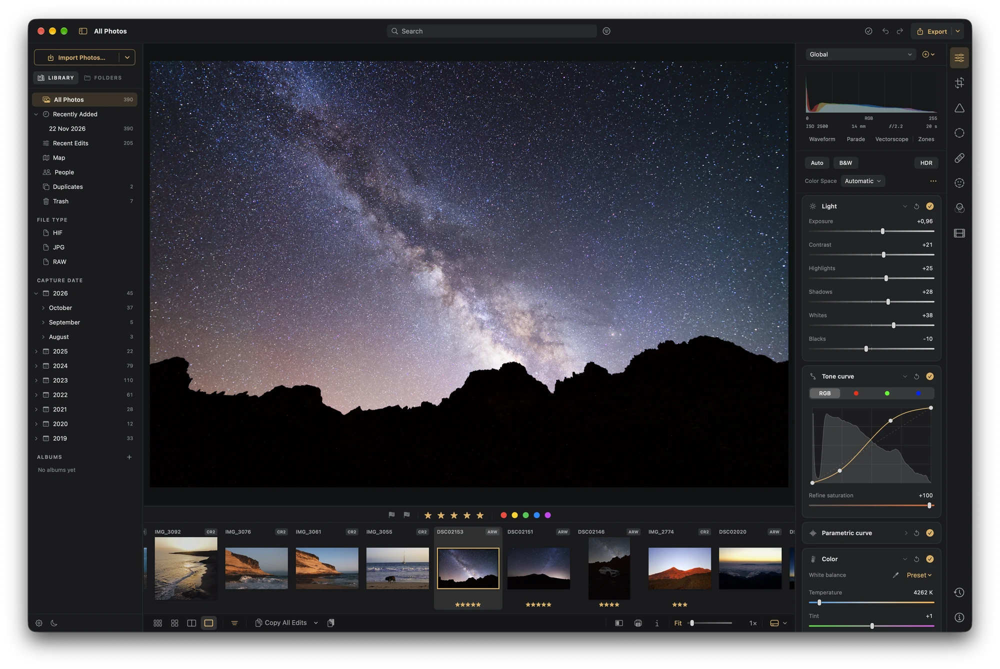

# Ceviche RAW Studio



A native macOS photo catalog and RAW darkroom: SwiftUI, Apple's Core Image RAW decoder, a Metal image pipeline and a
local SQLite catalog. Edits are nondestructive and stay in the catalog; originals are never overwritten.

- Library: local or iCloud catalogs, folder browsing, albums, search, culling tools
- Develop: tone, color, curves, masks, noise reduction, defringe, dust spots, crop and upright, retouch and AI fill
- Merges: panorama, HDR, night sky, focus stack
- Darkroom film printing, camera profiles and LUTs, XMP sidecars and presets
- Export to every format ImageIO offers, plus WebP and JPEG XL; MCP server for AI clients

English, Spanish, Italian, Simplified and Traditional Chinese.

## Requirements

macOS 15 or later on Apple silicon. Some features need newer systems and are disabled before them (Object
selection needs macOS 27). **Help › System Info…** checks a Mac's RAM and GPU.

The face models behind People and People masks are built in. The Core ML models behind depth, scene and sky masks, AI
denoise and AI fill are not: **Ceviche › Settings… › Models** downloads them, FP16 or a smaller INT8 copy, from a
separately versioned model-set release, verified by checksum.

macOS's RAW decoder develops a DNG only up to a maximum width or height, which can differ between macOS versions;
past it the picture comes out blank. Merges can pass it: a medium-format Pixel Shift set is kept as TIFF or JPEG
instead of DNG, but a panorama that wide is still saved as a DNG that develops blank. Some cameras store all of a
Pixel Shift capture's exposures in one RAW (the Hasselblad H6D-400c MS); such a file can be past the limit itself, so it
has no preview and can't be developed, yet Merge Pixel Shift still makes a usable TIFF or JPEG from it, which has no
such limit.

## Build

Needs Xcode 27 (the macOS 27 SDK).

```sh
make run        # release build into app/dist/Ceviche.app, then open it
make dev        # fast debug build, then relaunch
make test       # the test suite
make help       # every target
```

Build settings (team, signing, iCloud) go in `build.config`; copy `build.config.example`. See
[Building](docs/development/building.md). Test photos are not in the repository; tests that need one skip.

## Documentation

[Features](docs/features.md) lists what the app does. [docs/](docs/README.md) covers building, testing and internals; planned work is in [ROADMAP.md](ROADMAP.md).
`Ceviche.app/Contents/MacOS/Ceviche --help` lists the command-line options; AI clients connect through
**Settings › MCP**.

## License

Ceviche is licensed under the Apache License 2.0; see [LICENSE](LICENSE). Third-party code, data and film profiles
keep their own licences, listed in [app/licenses/CREDITS.md](app/licenses/CREDITS.md) and shown in
**Help › Open Source Licenses**; the downloadable models' licences are in [models/MODELS.md](models/MODELS.md). The border
pictures and dust and scratch textures in `app/Sources/CevicheCore/Resources` were generated with an image model for
this project and are under the project's licence.
