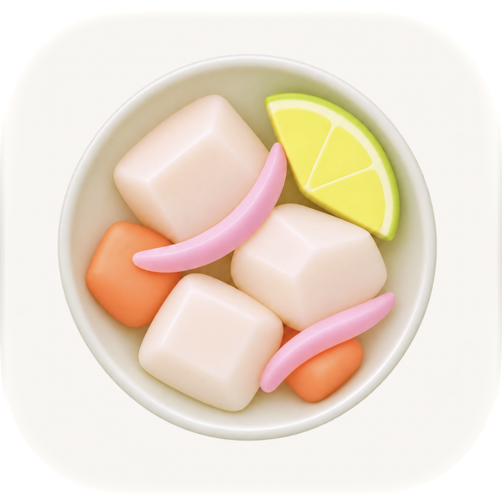

# Ceviche identity

The soft porcelain ceviche bowl and lowercase Nunito Bold 700 wordmark were adopted on 27 November 2026.
The app icon is authored in [AppIcon.icon](../../../app/Platforms/macOS/Resources/AppIcon.icon), an editable
Icon Composer package shared by the Mac, iPhone and iPad apps.



<picture>
  <source media="(prefers-color-scheme: dark)" srcset="wordmark-reversed.svg">
  
</picture>

## App icon

Open `app/Platforms/macOS/Resources/AppIcon.icon` with Icon Composer. Its `icon.json` defines a porcelain background,
with a graphite dark appearance, and a separate `Assets/Bowl.png` foreground. The foreground is a 1024-pixel RGBA
layer with the bowl occupying approximately three quarters of the canvas. Its food and internal shading stay
intact; the surrounding canvas and cast shadow were removed with built-in imagegen. The bowl is a single artwork
layer, so the ingredients are not individually editable in Icon Composer.

The foreground's glass effects and specular highlights are disabled to preserve the matte porcelain treatment.
A restrained group shadow is native. Icon Composer supplies the platform enclosure and derives the tinted and
clear appearances while preserving the bowl's tonal detail. No rounded-square mask or outer platform shadow is
painted into the foreground. Default, dark, tinted and clear renders were inspected with Xcode 27.2's `ictool`;
the package compiles with `actool` for macOS 15+ and iOS/iPadOS 26+.

The Xcode target selects `AppIcon` through `ASSETCATALOG_COMPILER_APPICON_NAME`. The synchronized Resources group
explicitly treats `AppIcon.icon` as an Icon Composer package. Xcode compiles it into the app's asset catalog and
also generates the compatibility icon for older systems. The tracked PNG and `.icns` exports are excluded from
Copy Bundle Resources to avoid competing with those generated outputs.

## Tracked assets

| File | Purpose |
| --- | --- |
| `../../../app/Platforms/macOS/Resources/AppIcon.icon` | Canonical editable app icon: appearance settings and the transparent bowl artwork. |
| `../../../app/Platforms/macOS/Resources/AppIcon.png` | Native default macOS render for documentation and previews. |
| `../../../app/Platforms/macOS/Resources/AppIcon.icns` | Xcode-generated compatibility export for external distribution tools. Normal app builds generate their own. |
| `bowl-source.png` | Original opaque artwork; retained for the identity and extraction provenance, not used as the app icon. |
| `wordmark.svg`, `wordmark-reversed.svg` | Nunito Bold 700 glyph outlines, in graphite and porcelain, with the font's default spacing. No installed font is required. |
| `fonts/Nunito.ttf` | Unmodified variable font used to reproduce the outlines; not bundled in the app. |
| `bowl-system.png` | Approved concept presentation. Native Icon Composer renders supersede its icon mockups, and the SVG wordmarks supersede its type study. The flat monochrome bowl remains a concept. |
| `bowl-system-prompt.json`, `bowl-source-prompts.json`, `icon-composer-prompt.json` | Built-in imagegen prompts and artwork provenance. |

Three ivory fish pieces, two coral pieces, one lime wedge and two short pink onion strips form a fixed composition,
with a thin shallow rim. Keep its proportions and placement; do not stretch it to fill the frame. Avoid enclosing
onion crescents, star-shaped garnish or letter motifs. Keep the wordmark clear of the bowl rim and shadow.

## Wordmark and color

Use lowercase `ceviche`, Nunito Bold 700, upright, with default spacing. The outlined exports are the canonical
wordmarks. Porcelain `#F8F5F1` and graphite `#423D37` are their background/foreground roles; coral, lime and onion
pink stay in the bowl artwork. Icon Composer owns the app background's appearance adjustments.

Nunito is by Vernon Adams, Cyreal and Jacques Le Bailly. The source font is pinned to upstream revision
`8c6a9bb9732545b9ed53f29ec5e1ab0ff53c4e6f`; its SHA-256 is
`bb55a5ca5c2042335b3991af27c4d0705d0ef41cac6164ac737fd8f2a1e85207`.
Its [SIL Open Font License](../../../app/Sources/CevicheMac/Resources/OpenSourceLicenses/credits/nunito/LICENSE)
and [source record](../../../app/Sources/CevicheMac/Resources/OpenSourceLicenses/credits/nunito/SOURCE.txt)
are registered in the credits manifest as an identity export dependency.

## Rebuilding

From the repository root with Xcode and its bundled Icon Composer installed:

```sh
bash app/scripts/app-icon.sh
swift app/scripts/identity.swift
python3 -I app/scripts/credits.py
```

The first command compiles `AppIcon.icon` with `actool` and exports the preview with `ictool`. It does not create
another hand-drawn platform frame. The second command only regenerates the outlined wordmarks with Core Text.
Commit the package, exports and related documentation together. When sharing the icon with another app, copy the
whole `.icon` directory, keep the target's app icon name as `AppIcon`, and remove the obsolete flat app icon set.
Inspect the native default, dark, tinted and clear renders, including small sizes, after changing the artwork.

See [Apple's Icon Composer integration guide](https://developer.apple.com/documentation/xcode/creating-your-app-icon-using-icon-composer)
and [app icon guidelines](https://developer.apple.com/design/human-interface-guidelines/app-icons/).
